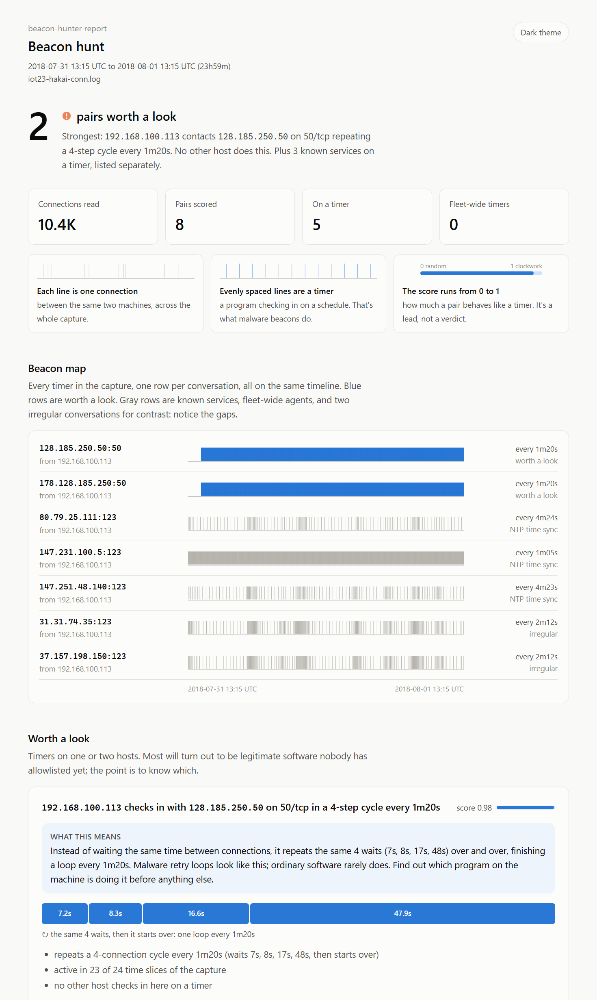
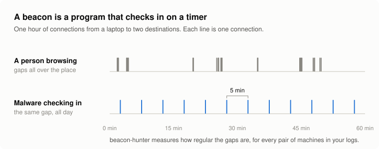

# beacon-hunter

[](https://github.com/jhunte-sec/beacon-hunter/actions/workflows/tests.yml)

Finds malware "phoning home" in network logs. It spots machines that contact the same server on a timer, explains each one in plain English, and writes a one-file report you can attach to a ticket.

<picture>
  <source media="(prefers-color-scheme: dark)" srcset="docs/img/report-dark.png">
  
</picture>

<sub>The report above is from a real malware capture (IoT-23, Hakai botnet), not a mockup. Both of the malware's command servers come out on top, and the card explains the retry loop it uses.</sub>

## What it looks for

Once malware is on a machine, it has to check in with its operator for instructions. It usually does that on a timer, and a timer leaves a pattern in network logs that people browsing never do:

<picture>
  <source media="(prefers-color-scheme: dark)" srcset="docs/img/beacon-vs-browsing-dark.svg">
  
</picture>

## Where the standard method breaks

The usual test is simple: are the gaps between connections always the same? Real malware breaks it in two ways.

<picture>
  <source media="(prefers-color-scheme: dark)" srcset="docs/img/missed-checkins-dark.svg">
  
</picture>

<picture>
  <source media="(prefers-color-scheme: dark)" srcset="docs/img/cycle-dark.svg">
  
</picture>

beacon-hunter handles both: it folds missed check-ins back onto the timer, and it checks whether each gap matches the one a few places later to find repeating cycles. How each works, with the maths, is in [docs/how-it-works.md](docs/how-it-works.md).

## Does it work on real malware?

I tested it on [IoT-23](https://www.stratosphereips.org/datasets-iot23), a public dataset of real malware traffic where every connection is labeled:

<picture>
  <source media="(prefers-color-scheme: dark)" srcset="docs/img/results-dark.svg">
  
</picture>

And in simulation, where the right answer is known exactly, missed check-ins stop being a problem:

<picture>
  <source media="(prefers-color-scheme: dark)" srcset="docs/img/simulation-dark.svg">
  
</picture>

Neither improvement made random traffic look like a beacon: 0 false alarms in 1,500 simulated samples. The full write-up, including what it **doesn't** catch and why, is in [docs/evaluation.md](docs/evaluation.md).

## Quick start

Python 3.10 or newer, no dependencies.

```bash
git clone https://github.com/jhunte-sec/beacon-hunter
cd beacon-hunter
pip install -e .

python examples/make_demo_log.py demo-conn.log
beacon-hunter demo-conn.log --allowlist examples/allowlist.txt --explain --html report.html
```

The demo log is synthetic: one planted beacon plus the kind of regular-but-harmless traffic that causes false positives on real networks.

```
score  source      destination            conns  every  jitter  missed  bytes  hosts  timing  size  persist
-----  ----------  ---------------------  -----  -----  ------  ------  -----  -----  ------  ----  -------
0.99   10.0.20.22  192.0.2.80:443/tcp     24     1h00m  0%      -       1830   1      0.99    1.00  1.00
0.95   10.0.20.15  203.0.113.50:443/tcp   289    4m59s  7%      -       412    1      0.95    0.88  1.00
0.63   10.0.20.41  198.51.100.25:443/tcp  150    7m11s  63%     -       31082  2      0.55    0.26  1.00

0.99  10.0.20.22 -> 192.0.2.80:443/tcp
      - checks in every 1h00m; almost exactly
      - sends exactly 1830 bytes in 100% of check-ins
      - active in 24 of 24 time slices of the capture
      - no other host checks in here on a timer

0.95  10.0.20.15 -> 203.0.113.50:443/tcp
      - checks in every 4m59s; half the gaps are within 7% of that
      - sends exactly 412 bytes in 76% of check-ins
      - active in 24 of 24 time slices of the capture
      - no other host checks in here on a timer
```

The top result is the demo's harmless hourly update check, and it really is the most timer-like thing in the log. That is normal: plenty of legitimate software runs on a timer. The score finds candidates; the explanations and next steps in the report are what let you clear them quickly.

## The report

`--html report.html` writes a single file with no outside dependencies, dark by default with a light theme toggle:

- **The verdict first:** how many conversations are worth a look, and the strongest one in a sentence.
- **A beacon map:** every timer in the capture on one timeline, so clockwork rows stand out from irregular ones.
- **A card per finding:** what it means in plain English, a zoomed-in view of the actual rhythm, a diagram of the cycle if there is one, and next steps for confirming or clearing it.
- **Known services and fleet-wide agents** (NTP, DNS, SIEM heartbeats) in their own tables, with ready-made allowlist lines.

## On your own logs

```bash
beacon-hunter /opt/zeek/logs/2026-10-03/conn.*.log.gz --html report.html
beacon-hunter conn.log --json > findings.json      # for a SIEM or a notebook
```

It reads Zeek's default tab-separated logs and JSON logs, gzipped or not, including JSON where a pipeline flattened `id.orig_h` to `id_orig_h` (as Wazuh and Logstash often do). Pass a whole day of rotated logs at once.

| option | what it does |
|---|---|
| `--allowlist FILE` | skip destinations you've confirmed (`10.0.0.20:1514`, `*:123`, `10.0.0.0/8`); see [examples/allowlist.txt](examples/allowlist.txt) |
| `--explain` | print the reasons for each result under the table |
| `--html FILE` | write the self-contained report |
| `--json` | machine-readable output, one object per pair |
| `--top N`, `--min-score X` | limit the table |
| `--min-events N` | check-ins needed before a pair is scored (default 10) |
| `--merge-window S` | connections closer than this count as one check-in (default 1 s) |
| `--no-port` | group by host pair, ignoring the destination port |
| `--no-fold`, `--no-cycles` | turn off the two timing improvements, to compare |

**Build your allowlist first.** On any real network the first run is dominated by things that are supposed to run on a timer: NTP, DNS, your SIEM and EDR agents, update checkers. The report helps: timers seen on three or more hosts get their own section with ready-made allowlist lines (check them first, since a worm spreading across hosts looks fleet-wide too), and known timer services like NTP are listed after unknown ones.

## How it works

Connections are grouped by source, destination, port and protocol, and each group gets three scores between 0 and 1:

- **timing:** are the gaps between check-ins regular? Median absolute deviation and quartile skew of the gaps, plus missed-check-in folding and cycle detection
- **size:** does each check-in send the same number of bytes?
- **persistence:** does it keep going across the whole capture?

The details, with worked numbers, are in [docs/how-it-works.md](docs/how-it-works.md).

## Limitations

- **Timing only.** It sees `conn.log`: timestamps, ports and byte counts. No payloads, TLS fingerprints or DNS names.
- **A single long-lived connection is invisible.** Some C2 holds one session open instead of checking in. That is one log line, and no timing method can see it.
- **Grouping is by IP.** A beacon to a big CDN shares its destination with legitimate traffic, which blurs the timing.
- **Long sleeps need long captures.** Ten check-ins at a 6-hour interval means more than two days of logs.
- **Regular is not malicious.** IoT devices and update agents call home on timers too. It finds candidates; a person decides.

## Data

The evaluation uses [IoT-23](https://www.stratosphereips.org/datasets-iot23) by the Stratosphere Laboratory, CTU Prague (Parmisano, Garcia, Erquiaga), CC BY. The logs are downloaded separately, not included; see [eval/README.md](eval/README.md).

## License

MIT
