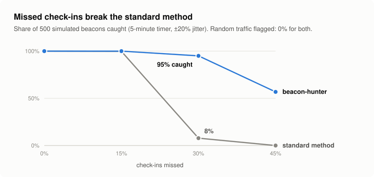
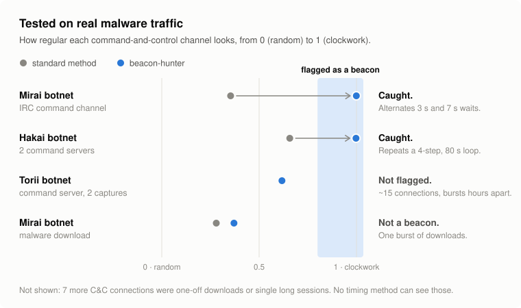
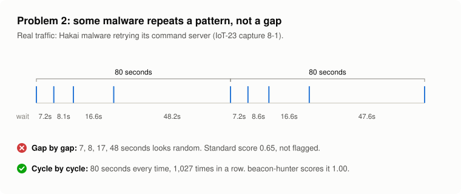

# Evaluation

Two questions, answered separately:

1. **Do the timing improvements actually help, and what do they cost?** Answered by simulation, where the ground truth is known exactly.
2. **Do they find real command-and-control traffic?** Answered on IoT-23, a public dataset of real malware captures with every connection labeled.

Both are reproducible: `python eval/simulate.py` (seeded, about two seconds) and `python eval/iot23.py eval/data/*.labeled` after downloading the logs (see `eval/README.md`). `python eval/plot.py` redraws the figures.

## 1. Simulation

<picture>
  <source media="(prefers-color-scheme: dark)" srcset="img/simulation-dark.svg">
  
</picture>

`eval/simulate.py` generates 500 trials per row: beacons with 200 check-ins every 300 s, uniform jitter, and a share of check-ins dropped at random; beacons that repeat a multi-step pattern; and three kinds of traffic that is *not* a beacon. Each row is the share of trials scored as a timer (timing score ≥ 0.8) by plain scoring (median absolute deviation and skew of the gaps, the textbook approach) and by beacon-hunter (plus missed-check-in folding and cycle detection).

| traffic | jitter | missed check-ins | plain | beacon-hunter |
|---|---|---|---|---|
| beacon | ±10% | 0% | 100% | **100%** |
| beacon | ±10% | 15% | 100% | **100%** |
| beacon | ±10% | 30% | 7% | **100%** |
| beacon | ±10% | 45% | 0% | **96%** |
| beacon | ±20% | 0% | 100% | **100%** |
| beacon | ±20% | 15% | 100% | **100%** |
| beacon | ±20% | 30% | 8% | **92%** |
| beacon | ±20% | 45% | 0% | **49%** |
| beacon | ±30% | 0% | 100% | **100%** |
| beacon | ±30% | 15% | 99% | **100%** |
| beacon | ±30% | 30% | 8% | **78%** |
| beacon | ±30% | 45% | 0% | **22%** |
| cycle 7 / 8.5 / 17 / 48 s | ±5% | 0% | 0% | **100%** |
| cycle 7 / 8.5 / 17 / 48 s | ±15% | 0% | 0% | **100%** |
| cycle 3 / 7 s | ±10% | 0% | 0% | **100%** |
| cycle 5 / 5 / 50 s | ±10% | 0% | 0% | **100%** |
| random (Poisson) | - | - | 0% | **0%** |
| browsing sessions | - | - | 0% | **0%** |
| uniform 10 to 600 s | - | - | 0% | **0%** |

**What this shows**

- Plain scoring falls off a cliff between 15% and 30% missed check-ins. Below about a quarter, the doubled gaps are outliers and the median ignores them. Above it, they *are* the spread, and detection drops to under 10%.
- Folding holds detection at 92 to 100% for jitter up to ±20% with 30% of check-ins missing, and still catches about half at ±20% with 45% missing.
- A beacon that repeats a pattern of different gaps is invisible to plain scoring (0%) and always found with cycle detection (100%).
- **No false positives were added:** none of the 1,500 non-beacon trials was called a timer either way.
- The honest limit: at ±30% jitter *and* 45% missed, the multiples blur into each other and only 22% are recovered.

## 2. IoT-23: real malware traffic

[IoT-23](https://www.stratosphereips.org/datasets-iot23) (Stratosphere Laboratory, CTU Prague, CC BY) contains Zeek logs of real malware running on a Raspberry Pi, with every connection labeled. Labels starting with `C&C` are the ground truth here. I used the seven malware captures and two benign devices whose logs are small enough to download individually.

<picture>
  <source media="(prefers-color-scheme: dark)" srcset="img/results-dark.svg">
  
</picture>

<picture>
  <source media="(prefers-color-scheme: dark)" srcset="img/cycle-dark.svg">
  
</picture>

### Per capture

"Scorable" means the pair had the 10+ check-ins needed to judge timing at all. "Worth a look" is the section of the HTML report for timers seen on one or two hosts, in the order the report lists them.

| scenario | family | connections | pairs scored | C&C pairs | C&C pairs scorable | best C&C rank by raw score | C&C called a timer | place in "worth a look" |
|---|---|---|---|---|---|---|---|---|
| CTU-Honeypot-Capture-4-1 | Philips Hue (benign) | 452 | 9 | 0 | 0 | - | 0 of 0 | - |
| CTU-Honeypot-Capture-5-1 | Amazon Echo (benign) | 1,374 | 12 | 0 | 0 | - | 0 of 0 | - |
| CTU-IoT-Malware-Capture-20-1 | Torii | 3,209 | 12 | 1 | 1 | 11 | 0 of 1 | - |
| CTU-IoT-Malware-Capture-21-1 | Torii | 3,286 | 27 | 1 | 1 | 14 | 0 of 1 | - |
| CTU-IoT-Malware-Capture-3-1 | Muhstik | 156,103 | 98 | 5 | 0 | - | 0 of 0 | - |
| CTU-IoT-Malware-Capture-34-1 | Mirai | 23,145 | 12 | 1 | 1 | 3 | 1 of 1 | 1 of 5 |
| CTU-IoT-Malware-Capture-42-1 | Trojan | 4,426 | 12 | 1 | 0 | - | 0 of 0 | - |
| CTU-IoT-Malware-Capture-44-1 | Mirai | 237 | 7 | 2 | 1 | 7 | 0 of 1 | - |
| CTU-IoT-Malware-Capture-8-1 | Hakai | 10,403 | 8 | 2 | 2 | 2 | 2 of 2 | 1 of 5 |

### Every scorable C&C pair

| scenario | C&C destination | connections | timing, plain | timing, beacon-hunter | what the report says |
|---|---|---|---|---|---|
| CTU-IoT-Malware-Capture-20-1 (Torii) | 66.85.157.90:443/tcp | 16 | 0.63 | **0.63** | loosely periodic around 8s; half the gaps are within 15% of that |
| CTU-IoT-Malware-Capture-21-1 (Torii) | 66.85.157.90:443/tcp | 14 | 0.61 | **0.61** | loosely periodic around 8s; half the gaps are within 15% of that |
| CTU-IoT-Malware-Capture-34-1 (Mirai) | 185.244.25.235:6667/tcp | 6,706 | 0.35 | **1.00** | repeats a 2-connection cycle every 10s (waits 3s, 7s, then starts over) |
| CTU-IoT-Malware-Capture-44-1 (Mirai) | 46.101.251.172:80/tcp | 24 | 0.28 | **0.37** | no clear timer: typical gap 2s, but half the gaps are more than 6% off |
| CTU-IoT-Malware-Capture-8-1 (Hakai) | 128.185.250.50:50/tcp | 4,110 | 0.67 | **1.00** | repeats a 4-connection cycle every 1m20s (waits 7s, 8s, 17s, 48s, then starts over) |
| CTU-IoT-Malware-Capture-8-1 (Hakai) | 178.128.185.250:50/tcp | 4,112 | 0.65 | **1.00** | repeats a 4-connection cycle every 1m20s (waits 7s, 8s, 17s, 48s, then starts over) |

### What this shows

- **Two C&C channels that plain scoring misses become clear timers.** Hakai's C2 retries in a fixed 7, 8.5, 17, 48 s loop that repeats every 80 s; gap by gap it scores 0.65. Mirai's IRC channel alternates 3 s and 7 s; gap by gap it scores 0.35. Both score 1.00 with cycle detection and head the report's "Worth a look" list.
- **How the cycle detector was built matters for reading that result.** I designed it after studying the Hakai capture, so Hakai is not an independent test. I had not looked at the Mirai capture's timing before building it; Mirai is the out-of-sample check, and it held.
- **Ranked by raw score alone, NTP wins.** These devices poll NTP servers on a timer, and ntpd doubles its poll interval (64, 128, 256 s...), which folding reads as missed check-ins. The C&C pairs rank 2nd to 14th by raw score. That is why the report lists known timer services (NTP, DNS, agent heartbeats) after unknown ones, and why the first thing to allowlist on any network is your own time servers.
- **More than half the C&C traffic can't be judged by timing at all.** 7 of the 13 C&C pairs are one-off file downloads or Muhstik's C2, which holds a handful of long-lived connections on port 2407 instead of checking in. One long connection is one log line; no timing method sees it. That needs a different detector (long connections, file transfers).
- **Torii stays below the line.** 14 to 16 connections over 12 to 18 hours, in short bursts: loosely periodic (0.61 to 0.63), not called a timer.
- **The benign devices show the cost.** The Philips Hue checks in with Akamai every 15 minutes and AWS every hour (timing 0.92 to 1.00); the Amazon Echo pings its router and fetches over HTTP every 5 minutes. Timing alone can't tell that from an implant, so they land in "Worth a look" (4 and 3 entries) until someone confirms and allowlists them. That is the job the report's next steps are written for.
- **A caveat on the easy part:** these captures contain little besides the malware, NTP and DNS, so heading "Worth a look" here is a lower bar than it would be on an office network with hundreds of hosts.

Dataset citation: Stratosphere Laboratory. *A labeled dataset with malicious and benign IoT network traffic.* Agustin Parmisano, Sebastian Garcia, Maria Jose Erquiaga. https://www.stratosphereips.org/datasets-iot23
