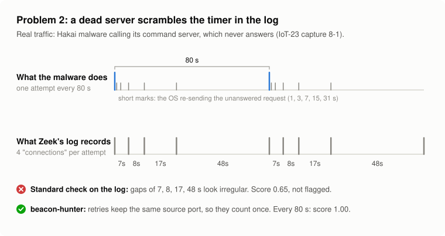
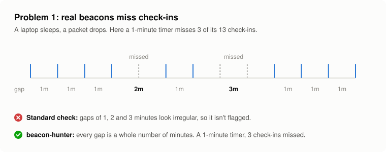

# How the scoring works

beacon-hunter groups connections by **source, destination, destination port and protocol** (and by **program**, when the log names one, as Sysmon does), then asks three questions about each group. Each answer is a number from 0 to 1.

## 1. Timing: does it check in on a timer?

Take the time between each check-in and the next. A person browsing produces gaps all over the place. An implant on a timer produces nearly the same gap every time, even when its operator adds random jitter.

Two measurements, both chosen because a few odd gaps (a laptop going to sleep, a dropped packet) don't throw them off the way an average would:

- **Regularity** = `1 - MAD / median`, where MAD is the median absolute deviation of the gaps.
  - A perfect 60-second timer: every gap is 60, MAD is 0, regularity is **1.0**.
  - 60 seconds with ±20% random jitter: gaps spread evenly between 48 and 72. Half of them sit within 6 s of 60, so MAD is about 6 and regularity is `1 - 6/60` = **0.9**.
  - Random human-like traffic (exponential gaps): MAD is about 0.69 of the median, so regularity is about **0.31**.
- **Symmetry** = `1 - |Bowley skew|`. Bowley skew compares the quartiles: `(Q3 + Q1 - 2·Q2) / (Q3 - Q1)`. Jitter added by an implant is usually symmetric around the interval (skew near 0). Random traffic has a long tail of big gaps (skew around 0.26).

  One catch, found on real data: when more than a quarter of the gaps are *identical*, two quartiles land on the same value and the skew jumps to its extreme, +1 or -1, however few odd gaps there are on one side. That punished the most clockwork-like traffic hardest. So the skew penalty is weighted by how much the typical gap varies (MAD / median): no penalty for a spike of identical gaps, full penalty once the typical gap is 10% or more off. Random traffic is always far above that, so it always pays in full.

`timing = 0.7 × regularity + 0.3 × symmetry`

The report also says how much of the traffic the timer **covers**: the share of gaps within 10% of the period, or within three typical deviations for a jittery timer. A timer that only explains 57% of the gaps says so ("checks in every 10s for 57% of gaps").

### Bursts count as one check-in

Some implants open two or three connections per check-in. Counted separately, the gaps would alternate tiny, large, tiny, large, and the timer would disappear. So connections less than `--merge-window` seconds apart (default 1 s) are merged into a single check-in first.

### Retries of one connection count once

<picture>
  <source media="(prefers-color-scheme: dark)" srcset="img/retries-dark.svg">
  
</picture>

When a server doesn't answer a connection request (a SYN), the operating system sends it again on the same socket: Linux after 1, 3, 7, 15 and 31 seconds. Zeek starts a new log record once an unanswered SYN is more than 5 seconds old (its `tcp_SYN_timeout`), so a single attempt shows up as several "connections". Hakai's C2 makes one attempt every 80 seconds; in Zeek's log it becomes four records, 7, 8, 17 and 48 seconds apart, and the standard score drops to 0.65.

Every retry keeps the original **source port**, so beacon-hunter treats TCP records from the same source port within 75 seconds as one attempt. That's TCP only: UDP clients like NTP legitimately reuse one port for every poll. The report also says when a server never answers, since malware calling a dead or sinkholed server on schedule is a strong signal in itself. `--no-retry-merge` turns this off.

The packet-capture reader doesn't need this step: it sees the retransmitted SYNs as one connection to begin with, as the operating system does.

### Missed check-ins are folded back onto the timer

<picture>
  <source media="(prefers-color-scheme: dark)" srcset="img/missed-checkins-dark.svg">
  
</picture>

Real beacons miss beats: a laptop sleeps, a packet drops. A 60-second timer then produces gaps like 60, 60, 120, 60, 180, and the regularity measure above reads that as irregular. So beacon-hunter also tries this:

1. **Estimate the base period** from the shortest gaps: the median of every gap up to 1.5 × the lower quartile.
2. **Fold** every gap that sits close to a whole multiple of it (up to 4×) back down: 120 becomes 2 × 60, 180 becomes 3 × 60. "Close" is ±15% of the period, widened up to ±35% when the shortest gaps are themselves jittery.
3. **Score the folded gaps** with the same timing formula, then multiply by the share of gaps that fit. Traffic that only half lines up gets only half the credit.

The higher of the plain and folded scores wins. The report then says roughly what share of expected check-ins was missing.

Why this doesn't flag random traffic: random gaps rarely land near whole multiples of anything, so few of them fold and the multiplier keeps the score down. In the simulation study (docs/evaluation.md) it raised detection of beacons with 30% missed check-ins from under 10% to 95 to 100% (up to ±20% jitter), and added zero false positives across 1,500 non-beacon trials. `--no-fold` turns it off.

One side effect worth knowing: NTP clients double their poll interval as the clock settles (64, 128, 256 s...), and folding reads that as missed check-ins. NTP is listed separately as a known timer service, so this doesn't push it up the findings.

### Repeating cycles are found as a whole

Some timers repeat a fixed *sequence* of waits instead of one gap: for example 5, 5 and 50 seconds, over and over. Each gap on its own looks scattered, but two things give it away:

- **Every gap matches the one k places later.** Compare each gap with the gap 2, 3, ... 6 places further on. For a cycle of k steps, they match: the median relative difference is close to 0. Random gaps don't match their neighbours at any distance (for random traffic the median relative difference is around 0.5 to 0.67).
- **Every k-th connection lands a constant time after the last.** The sum of k consecutive gaps is the cycle length, and those sums are as regular as an ordinary timer.

beacon-hunter needs the first test to pass (median relative difference ≤ 0.15) before it scores the k-step sums as the timer. The order matters: sums of random gaps also get smoother as k grows, so scoring the sums on their own would flag random traffic. The recurrence test doesn't have that problem. A cycle is only claimed with at least 30 gaps, a pattern that genuinely varies (the longest step at least 1.3× the shortest), and a cycle steady enough to score as a timer. It is tried when a plain timer scores low or leaves more than 10% of the gaps unexplained, and wins when it explains more of them. `--no-cycles` turns it off.

An honest note on where this matters: I first built it for Hakai's "7, 8, 17, 48 seconds" pattern, which turned out to be the retry artifact above, not a cycle in the malware. Cycle detection still recovers those timers from logs that don't record source ports (some CSV exports), and catches genuine multi-step patterns in simulation, but in the real captures tested so far retry merging is what does the work.

## 2. Size: does each check-in send about the same amount?

A check-in that has nothing new to report sends the same small request every time. Using the bytes the source sent (`orig_bytes`):

`size = 0.5 × regularity(bytes) + 0.5 × share of check-ins that sent the single most common size`

If fewer than half the connections have a byte count (some protocols and some logs don't record it), this score is left out instead of guessed.

## 3. Persistence: does it keep going?

The capture is cut into `--slices` equal time slices (default 24, so hours for a day of logs). Persistence is the share of slices in which the pair was active. A beacon runs all day, so it scores 1.0. A two-minute burst scores 1/24.

This is measured against the whole capture, not just the pair's own lifetime. A beacon that started halfway through the day scores 0.5. That's on purpose: it keeps one-off bursts from looking persistent. The trade-off is that a fresh infection late in the capture ranks lower than it should.

## Final score

A weighted average: **timing 0.5, persistence 0.3, size 0.2**. When the size score is missing, the other two are re-weighted so they still add up to 1.

The number is for ranking, not a verdict. Always read the three parts. A high timing score with a low size score means "regular, but different amounts each time", which looks more like polling an API than an implant asking for orders.

## What it will flag that isn't malicious

Plenty of legitimate software runs on a timer. Expect to see:

- NTP time sync, DNS resolvers, SIEM and EDR agent heartbeats
- update checkers, licence checks, cloud sync clients
- monitoring and health checks, and IoT devices calling home

This is what the allowlist is for. Building one for your own network is part of using the tool, the same way tuning is part of any detection.

## What it will miss

- **Beacons with very long sleeps.** Ten check-ins (the default `--min-events`) at a 6-hour interval needs more than two days of logs.
- **Heavy jitter plus missed check-ins.** At ±30% jitter with 45% of check-ins missed, the multiples blur together and only about a fifth are recovered (see docs/evaluation.md).
- **Domain fronting and shared infrastructure.** Grouping is by IP. A beacon to a big CDN shares its destination IP with legitimate traffic, which blurs the timing.
- **One long-lived connection.** C2 that holds a session open instead of checking in is a single log line.
- **Sysmon has no byte counts**, so the size score drops out for Sysmon sources and the other two carry the score.
- **Anything that is not in a connection record.** It sees timing, ports and sizes only. No payloads, no TLS details, no DNS names.
